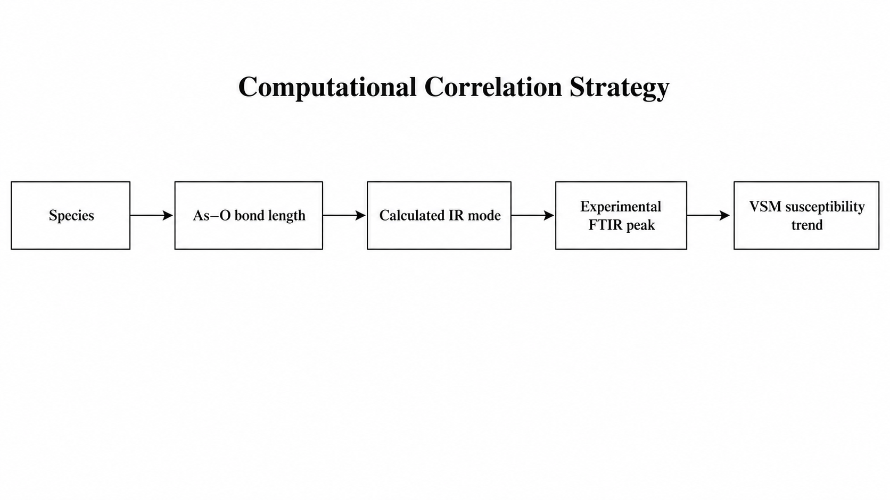

# Speciation-Dependent Magnetic Response of Inorganic Arsenic Species

**DFT (ORCA) + Langevin transport modelling + FTIR / VSM data for As(III) and As(V) in water**

[](https://www.faccts.de/orca/)
[-6f42c1)](#1-quantum-chemistry-orca)
[](langevin_md/arsenic_langevin_md.py)
[](LICENSE)
[](LICENSE-DATA)

This is the computational and data companion to my B.Sc. (Hons) Physics thesis at Manipal Institute of Applied Physics, MAHE (defended May 2026).

The question: **do As(III) and As(V) look different by vibrational spectroscopy and by magnetometry, and can quantum chemistry explain why?**



---

## Key results

| Technique | What was done | Main finding |
|---|---|---|
| **DFT (ORCA 6.1.1)** | Opt + Freq on H₃AsO₃, H₂AsO₃⁻, H₂AsO₄⁻ (r²SCAN-3c, CPCM water) | All three are true minima (no imaginary modes). The As–O bonds split cleanly by oxidation state: 1.80 Å in As(III)–OH, 1.65 Å in As(V)=O |
| **Calculated IR** | Harmonic modes, 450–1200 cm⁻¹ | As(III) has strong modes at ~602, 650 and 965–972 cm⁻¹. As(V) has strong modes at 778–833 and 1100–1110 cm⁻¹ |
| **FTIR (experiment)** | 10 samples: 50–500 ppb As(III)/As(V) standards plus 2 field groundwater samples. Gaussian peak fitting | Speciation-dependent band patterns in the 500–1100 cm⁻¹ As–O region |
| **VSM (experiment)** | M–H loops on NaAsO₂, Na₂HAsO₄·7H₂O and an aqueous As(V) specimen | All specimens are net **diamagnetic**, with χ_mass ≈ −6.9 to −9.5 × 10⁻⁹ m³ kg⁻¹ (high-field linear fit, R² > 0.998) |
| **Langevin–Lorentz model** | Implicit-water centre-of-mass dynamics at B = 0–10 T, 298 K | The Lorentz perturbation number \|q\|B/ζ is ≤ 5 × 10⁻⁷. Direct magnetic steering of dissolved arsenic ions is negligible |

**Conclusion:** speciation leaves a clear fingerprint in bonding and vibrational structure. Bulk magnetic response of dissolved ions is too weak to serve as a standalone detection mechanism. Practical magnetometric sensing would need preconcentration or immobilisation first.

---

## Repository layout

```
.
├── dft_orca/
│   ├── inputs/              # all ORCA inputs (fast r²SCAN-3c + production PBE0-D4/def2-TZVP + NMR template)
│   ├── outputs/             # .out / .hess / .property.txt for the 3 converged jobs
│   ├── structures/          # optimised geometries (.xyz)
│   ├── analysis/            # extracted IR modes and structure QC tables
│   ├── extract_ir_modes.py  # parses IR SPECTRUM blocks from .out files
│   └── run_all_fast_windows.bat
├── langevin_md/
│   ├── arsenic_langevin_md.py   # underdamped Langevin + Lorentz-force simulation
│   ├── results/                 # MSD, diffusion, Lorentz-number tables
│   └── figures/
├── experimental/
│   ├── ftir/   raw/ (10 spectra) · processed/ (peak fits, Origin-ready CSV) · figures/
│   └── vsm/    raw/ (3 M–H runs) · processed/ (susceptibility tables) · figures/
└── docs/
```

---

## 1. Quantum chemistry (ORCA)

| Species | Role | Charge | As–O (Å) | Status |
|---|---|---|---|---|
| H₃AsO₃ | neutral As(III), dominant near pH 7 | 0 | 1.798 ×3 | ✅ converged, 0 imaginary |
| H₂AsO₃⁻ | As(III) anion (alkaline arsenite) | −1 | 1.684, 1.872 ×2 | ✅ converged, 0 imaginary |
| H₂AsO₄⁻ | As(V), dihydrogen arsenate | −1 | 1.650 ×2, 1.796 ×2 | ✅ converged, 0 imaginary |
| HAsO₄²⁻ | As(V), hydrogen arsenate | −2 | – | ⏳ not yet converged (inputs included) |

**Level of theory:** `r2SCAN-3c TightSCF CPCM(Water) Opt Freq`. Production-level inputs (`PBE0 D4 def2-TZVP`) and an As NMR-shielding template are included for follow-up work.

Run on Windows:
```bat
cd dft_orca\inputs
..\run_all_fast_windows.bat
python ..\extract_ir_modes.py
```
Linux/macOS: `orca file.inp > file.out` (use the full path to the `orca` binary for parallel runs).

> The DFT models are isolated aqueous species in implicit solvent. They are **not** bulk reagent crystals or real water matrices. DFT is used here for bonding and vibrational interpretation only. VSM is the source of experimental susceptibility.

## 2. Langevin–Lorentz transport model

`langevin_md/arsenic_langevin_md.py` integrates

$$m\,\frac{d\mathbf v}{dt} = q(\mathbf v\times\mathbf B) - \zeta(\mathbf v-\mathbf u_\text{flow}) + \boldsymbol\xi(t),\qquad \zeta = \frac{k_BT}{D}$$

for 200 particles × 50 000 steps (dt = 1 fs) per species and field. It reports MSD-derived diffusion coefficients, the dimensionless Lorentz number |q|B/ζ, and a magnetic perturbation index.

```bash
pip install -r requirements.txt
cd langevin_md
python arsenic_langevin_md.py      # writes md_outputs/*.csv and *.png
```

> This is an **implicit-solvent, centre-of-mass** model, not atomistic water MD. It answers one bounded question: is the Lorentz force on a solvated arsenic ion significant compared with viscous drag? The answer is no.

## 3. Experimental data

**FTIR (May 2023).** `experimental/ftir/raw/sample_XX.csv` holds wavenumber against intensity.

| Sample | Description |
|---|---|
| 01–04 | As(III) standards: 500, 200, 100, 50 ppb |
| 05–08 | As(V) standards: 200, 100, 50, 500 ppb |
| 09 | groundwater field sample, natural |
| 10 | groundwater field sample, acidified |

**VSM (2022).** Raw M–H data (Field in Oe, Moment in emu) for an As(III) powder (NaAsO₂), an As(V) powder (Na₂HAsO₄·7H₂O) and an aqueous As(V) specimen. Mass-normalised curves and recalculated susceptibilities are in `processed/`.

---

## Limitations and next steps
- Converge HAsO₄²⁻ with explicit first-shell water (cluster-continuum) and rerun at PBE0-D4/def2-TZVP.
- Compute ⁷⁵As NMR shielding and magnetic susceptibility tensors (ORCA `%eprnmr`) to link electronic structure to the VSM trend.
- Replace the implicit-solvent Langevin model with explicit-water classical MD (GROMACS/OpenMM) using a validated arsenic force field.
- Cross-validate FTIR speciation with IC / ICP-OES.

## Citation
If you use this data or code, please cite it via [`CITATION.cff`](CITATION.cff):

> Kumar, A. (2026). *Speciation-Dependent Magnetic Response of Inorganic Arsenic Species: DFT, Langevin modelling and FTIR/VSM data.* B.Sc. thesis companion repository, Manipal Institute of Applied Physics, MAHE.

## License
Code: [MIT](LICENSE). Data and figures: [CC BY 4.0](LICENSE-DATA).

---
*Author: **Arpit Kumar** · [GitHub @4RP17](https://github.com/4RP17) · [LinkedIn](https://www.linkedin.com/in/arpit-kumar-i)*
